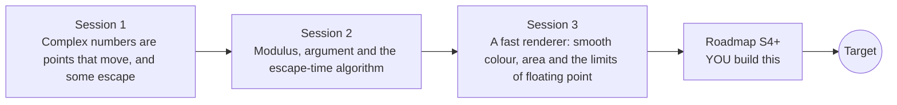

# openfractal

[](https://github.com/KrunalPanchal1995/openfractal/actions/workflows/ci.yml)   [](https://colab.research.google.com/github/KrunalPanchal1995/openfractal/blob/main/sessions/session-01/lesson.ipynb) [](https://krunalpanchal1995.github.io/openfractal/)

**Render a Mandelbrot and Julia zoom from complex numbers, in three sessions.**

openfractal teaches the mathematics behind fractal zoom videos, from complex numbers as points on a plane to a vectorised Mandelbrot renderer, using only Python and a browser.

- **Start from zero.** Session 1 needs only school algebra; complex numbers are explained from scratch.
- **See it move.** Every session ships a slider app that runs in the browser, with labelled graphs.
- **Know you got it right.** Each session ends with a checkpoint that prints PASS or FAIL against hand calculations and known points.
- **Build the missing half.** The repo stops at Session 3 on purpose; the roadmap shows the path to the Target zoom.

[Target](#the-target) · [Who is this for](#who-is-this-for) · [Quick start](#quick-start) · [Sessions](#sessions) · [Roadmap](#roadmap) · [Contribute](#contribute) · [Explainer PDF](docs/explainer.pdf)

> **This repo is incomplete on purpose.** Sessions 1 to 3 are here and fully working. The finished Target below is a preview of what the community can build next. We show you the path, not the code. Sessions 4 and up are yours.

## The Target

A deep zoom into the seahorse valley of the Mandelbrot set runs on the left, magnifying the picture about 500,000 times with the iteration budget growing as it goes. On the right, the Julia set of a parameter c that travels once around the main cardioid morphs from round shapes into dust and dendrites. Your goal over the coming sessions: render both yourself, then go deeper than ordinary double-precision numbers allow.


*Target: Mandelbrot deep zoom (left) beside a morphing Julia set (right)*

- [Neural ODE course: a conformal map deforming the complex plane (video)](promo/media/conformal_homotopy.mp4)

- [Neural ODE course: Moebius maps of the complex plane (video)](promo/media/mobius_classes.mp4)

Try it live:

- [Math Visual Studio: complex numbers (Atlas S07)](https://krunalpanchal1995.github.io/studio/#atlas?ch=S07&ex=1)
- [Math Visual Studio: the studio](https://krunalpanchal1995.github.io/studio/)

How the Target was made is shown only as a path in [promo/roadmap.md](promo/roadmap.md).

## Who is this for
**secondary school to diploma / undergraduate (levels 3-5).** Topic area: Mathematics and Visual Problem-Solving.

Prerequisites:

- Basic algebra: squaring a bracket such as (a + b)^2, and Pythagoras' theorem.
- Python 3.10 or newer; if `python --version` works, you are ready. PRIMER.md explains the rest.
- No prior GitHub, complex-number or image-processing experience is needed.

New to Python? Read [PRIMER.md](PRIMER.md) first (10 minutes).

## Quick start

No installation knowledge needed. You need [Git](https://git-scm.com/downloads) and [Python 3.10+](https://www.python.org/downloads/) (Windows: tick "Add Python to PATH"). On Mac and Linux type `python3` wherever this page says `python`.

```bash
git clone https://github.com/KrunalPanchal1995/openfractal.git
cd openfractal
python start.py 1
```

`start.py` creates a private environment, installs what is needed and runs Session 1 with its checkpoint. Next: `python start.py 2`, `python start.py 3`, or `python start.py test` to check everything. Only a checkpoint: `python start.py check 1`.

A few lines turn the idea of Session 1 into a result (they work as they are): Save it as `try.py` and run it with `python start.py run try.py` (this uses the private environment, where NumPy is installed):

```python
import numpy as np
c, z = 0.5 + 0.5j, 0j
for k in range(1, 8):
    z = z * z + c
    print(k, np.round(z, 3), 'ESCAPED' if abs(z) > 2 else '')   # escapes at step 5
```

Every session also opens in your browser with sliders (no install): [live apps](https://krunalpanchal1995.github.io/openfractal/). Or use the Colab badge above for the notebook.

## Sessions

| # | Session | Model level | Time | Live app |
|---|---|---|---|---|
| 1 | [Complex numbers are points that move, and some escape](sessions/session-01/README.md) | Level 1: conceptual interactive model | 60 min | [open](https://krunalpanchal1995.github.io/openfractal/session-01/) |
| 2 | [Modulus, argument and the escape-time algorithm](sessions/session-02/README.md) | Level 2: mathematical engineering model | 75 min | [open](https://krunalpanchal1995.github.io/openfractal/session-02/) |
| 3 | [A fast renderer: smooth colour, area and the limits of floating point](sessions/session-03/README.md) | Level 3: simulation and validation | 90 min | [open](https://krunalpanchal1995.github.io/openfractal/session-03/) |

Each session follows the same six steps: A real-world problem, B concept and theory, C visual explanation, D interactive simulation, E worked example and experiment, F assessment and design challenge. Each ends with `checkpoint.py`, which prints `PASS` or `FAIL` against reference numbers. Session 3 also contains the real-world mini-project: **Find and render a mini-Mandelbrot**.

## Architecture



| Folder or file | What is inside |
|---|---|
| `sessions/` | three sessions: README (A-F), `lesson.py`, notebook, live app, exercises, activity sheet, checkpoint |
| `promo/` | the Target: media, live links, and the roadmap (path only) |
| `docs/` | `explainer.tex` and the built `explainer.pdf` |
| `tests/` | runs every lesson and checkpoint headless |
| `start.py` | one command to set up and run anything |
| `QUALITY.md`, `RUBRIC.md` | the quality checklist and the scoring rubric |
| `.github/` | CI, PDF build, Pages deploy, issue and PR templates |

## Roadmap

| Milestone | What you will build | Difficulty |
|---|---|---|
| Session 4: Zoom beyond float64 with perturbation | A deep-zoom renderer that keeps one high-precision orbit and perturbs around it. | advanced |
| Session 5: Skip the interior | A faster renderer that returns the same picture for the same window. | intermediate |
| Session 6: A better area estimate | A second area estimator with a proper error bar. | intermediate |
| Session 7: A looping Julia morph | A Julia-set animation as GIF or MP4 with c on a closed path. | intermediate |
| Session 8: Zoom video with automatic iterations | A 120-frame zoom video that keeps the share of wrongly-inside pixels below 1 percent in every frame. | advanced |

Full detail with a checkpoint per milestone: [promo/roadmap.md](promo/roadmap.md).

## Contribute
New to GitHub? Read [CONTRIBUTING.md](CONTRIBUTING.md); it starts from zero. Pick an issue labelled `good first issue`. Translations into Hindi, Telugu, Tamil and Malayalam are welcome.

<details>
<summary>Development</summary>

```bash
python start.py test        # runs every lesson and checkpoint
```
Lessons use `# %%` cell markers so they open as notebooks in VS Code. See [QUALITY.md](QUALITY.md) for the standard every session meets.
</details>

## License
MIT. See [LICENSE](LICENSE). Media in `promo/media` is (c) Krunal Panchal, CC BY 4.0.

## Acknowledgments
Part of the [PAN IIT OSS](https://hellofoss.tech-iitb.org/projects) open-source teaching collection, modelled on the structure of [openspline](https://github.com/openspline/openspline). Built on ideas from the Math Visual Studio at https://krunalpanchal1995.github.io/studio/.
