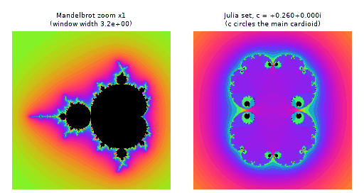

# What you are building toward

A deep zoom into the seahorse valley of the Mandelbrot set runs on the left, magnifying the picture about 500,000 times with the iteration budget growing as it goes. On the right, the Julia set of a parameter c that travels once around the main cardioid morphs from round shapes into dust and dendrites. Your goal over the coming sessions: render both yourself, then go deeper than ordinary double-precision numbers allow.

*Target: Mandelbrot deep zoom (left) beside a morphing Julia set (right)*

- [Neural ODE course: a conformal map deforming the complex plane (video)](media/conformal_homotopy.mp4)

- [Neural ODE course: Moebius maps of the complex plane (video)](media/mobius_classes.mp4)

These results come from a private reference build. The code is not published; the roadmap shows the path so you can build your own.

Live links:

- [Math Visual Studio: complex numbers (Atlas S07)](https://krunalpanchal1995.github.io/studio/#atlas?ch=S07&ex=1)
- [Math Visual Studio: the studio](https://krunalpanchal1995.github.io/studio/)
