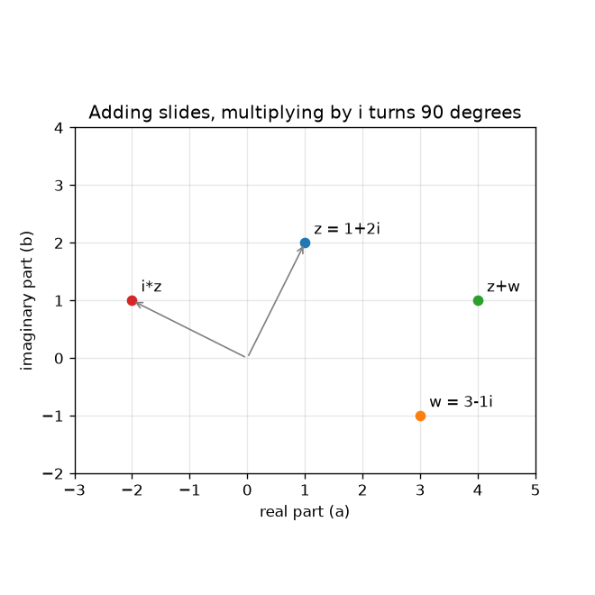
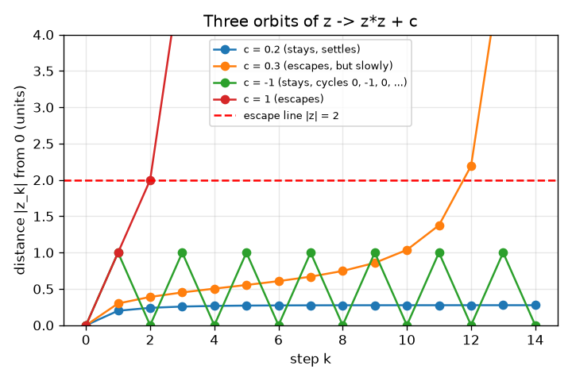

# Session 1: Complex numbers are points that move, and some escape

*Level 1 (conceptual interactive model) · about 60 minutes · openfractal*

> This is a simplified educational model. It is not a validated design tool and must not be used for real structures, electrical installations, vehicles, industrial processes or medical decisions.

**Prerequisites**

- Algebra: expanding (a + b)^2 and Pythagoras' theorem.
- You have read PRIMER.md and run `python start.py 1` once.

**Learning objectives.** After this session you can:

- Plot a complex number a + b i as a point (a, b) on a plane.
- Explain addition as a slide and multiplication by i as a quarter turn.
- Iterate z -> z^2 + c by hand and in Python and list the orbit.
- Decide whether an orbit escapes (distance from 0 above 2) or stays.

## A. Real-world problem
Every fractal picture and zoom video is built from one yes/no question asked for each pixel: if I keep applying the same rule, does the number run away? To ask it we need numbers that live on a plane, because a picture is a plane. Complex numbers are exactly that: a number with two parts, so one number is one point. Can we tell, just by repeating z -> z^2 + c a few times, which values of c are tame and which run away?

## B. Concept and theory
A complex number is z = a + b i, where a is the real part, b is the imaginary part and i is a new number with i * i = -1. We draw it as the point (a, b). Adding two complex numbers adds the real parts and the imaginary parts, which slides the point. Multiplying by i sends a + b i to -b + a i: the point is turned by 90 degrees about 0, and after four turns it is back where it started. The rule z -> z^2 + c is applied again and again from z0 = 0; the list z0, z1, z2, ... is the orbit of c. If the distance |z| from 0 ever exceeds 2 we say the orbit escapes (Session 2 shows why 2 is the right line); otherwise it stays.

| Symbol | Meaning | Unit |
|---|---|---|
| z | a complex number a + b i, a point (a, b) | no unit |
| c | the fixed constant of the rule | no unit |
| z_k | the orbit after k steps (z_0 = 0) | no unit |
| \|z\| | distance of z from 0, sqrt(a^2 + b^2) | no unit |
| k | step number | count |

**Assumptions**

- Numbers are plotted with the real axis along and the imaginary axis up.
- We always start from z0 = 0 in this session.
- A finite number of steps (30 in the app) stands in for 'forever'.

$$ z=a+bi,\qquad i^2=-1 $$

$$ (a+bi)+(c+di)=(a+c)+(b+d)i $$

$$ i\,(a+bi)=-b+ai\quad\text{(a quarter turn about }0\text{)} $$

$$ z_{k+1}=z_k^2+c,\qquad z_0=0 $$

## C. Visual explanation
The left figure shows the points 1 + 2i and 3 - 1i, their sum 4 + 1i, and 1 + 2i turned by i into -2 + 1i: adding slides, multiplying by i turns a quarter circle with the same distance from 0. The right figure plots the distance of the orbit from 0 against the step for four values of c. c = 0.2 settles at 0.276, c = -1 jumps between 1 and 0 for ever, c = 1 explodes within three steps, and c = 0.3 creeps upward for eleven steps and then escapes at step 12: slow escapes are the hard cases that will matter in Session 2.

*Adding slides a point; multiplying by i turns it by 90 degrees about 0.*

*Distance from 0 against step for four values of c: settles, escapes slowly, cycles, escapes fast.*

## D. Interactive simulation
Run the lesson (`python start.py 1`), then open the live app: [Session 1: the orbit of z -> z^2 + c](https://krunalpanchal1995.github.io/openfractal/session-01/) (or `app.html` in this folder). Move c and the step slider and watch the orbit hop across the plane; the dashed circle is distance 2. Then open the distance graph and see when the line crosses the red escape level.

**Challenge.** Find a c with distance at least 0.9 from 0 whose orbit still stays within 2 for 30 steps (hint: look at the real axis).

## E. Worked example and experiment
**Problem.** For c = 0.5 + 0.5i, find z1 to z5 and the step at which the orbit escapes.

1. z1 = 0*0 + c = 0.5 + 0.5i.
2. z2 = z1^2 + c. Now (0.5 + 0.5i)^2 = 0.25 + 0.5i + 0.25 i^2 = 0.5i, so z2 = 0.5 + 1.0i.
3. z3 = (0.5 + 1.0i)^2 + c = (0.25 - 1 + 1.0i) + c = -0.75 + 1.0i + 0.5 + 0.5i = -0.25 + 1.5i.
4. z4 = (-0.25 + 1.5i)^2 + c = (0.0625 - 2.25 - 0.75i) + c = -2.1875 - 0.75i + 0.5 + 0.5i = -1.6875 - 0.25i, with |z4| = 1.706 (still within 2).
5. z5 = (-1.6875 - 0.25i)^2 + c = (2.8477 - 0.0625 + 0.84375i) + c = 3.2852 + 1.3438i, with |z5| = 3.549 > 2.

**Answer.** z1 = 0.5 + 0.5i, z2 = 0.5 + 1.0i, z3 = -0.25 + 1.5i, z4 = -1.6875 - 0.25i, z5 = 3.285 + 1.344i; the orbit escapes at step 5.

**Experiment.** Do the same orbit on a pocket calculator that has complex mode, or with real and imaginary parts on paper, and compare with the app readout and checkpoint.py. They agree to every digit because the rule is exact arithmetic on a few numbers. The difference from a picture of a fractal is only the number of steps: paper stops after 5, the computer stops at the limit we choose, and that limit is where model and reality part ways (Session 2).

## F. Assessment and design challenge
**Question type A: Conceptual.** Why does multiplying by i turn a point by a quarter turn and never change its distance from 0?

Hint

Compute (a + b i) * i and compare the distances sqrt(a^2 + b^2) before and after.

Step-by-step solution

(a + b i) * i = a i + b i^2 = -b + a i, so the point (a, b) goes to (-b, a). The new distance is sqrt(b^2 + a^2), the same as before. The two points and 0 form a right angle (the vectors (a, b) and (-b, a) have dot product -ab + ab = 0), so it is a turn of 90 degrees counter-clockwise.

**Question type B: Numerical.** For c = 1 compute z1, z2, z3 and z4 by hand. At which step does the orbit first have distance above 2? Give the distances.

Hint

Each step is 'square, then add 1'. Everything stays real.

Step-by-step solution

z1 = 1, z2 = 1^2 + 1 = 2, z3 = 2^2 + 1 = 5, z4 = 5^2 + 1 = 26. The distance is 1, 2, 5, 26: it is exactly 2 at step 2 (not above) and above 2 at step 3, so the orbit escapes at step 3. Sanity check: after the first escape the distances roughly square each time (5, 26, 677).

**Question type C: Graph and simulation interpretation.** In the distance graph for c = -1, what pattern do you see, and why does the orbit never escape?

Hint

Compute z1, z2, z3 for c = -1.

Step-by-step solution

z1 = -1, z2 = (-1)^2 - 1 = 0, z3 = -1, z4 = 0 and so on: the distance alternates 1, 0, 1, 0 for ever (a cycle of length 2). It never reaches 2, so c = -1 stays. The graph is a zig-zag between 0 and 1, well below the red line.

**Question type D: Design and optimisation challenge.** Design: on the real axis (c with zero imaginary part), find by experiment the largest c for which the orbit still stays within 2 for 50 steps, to two decimal places, and the smallest negative c that does. What do you notice about the stay set?

Hint

Use escape_step(c, 50) in a loop over c = 0.20, 0.21, ... and over c = -1.90, -1.91, ...

Step-by-step solution

On the positive side c = 0.25 stays and c = 0.26 escapes (at step 30; the slow escapes close to 0.25 are why 50 steps is a rough test, see Session 2). On the negative side c = -2.00 stays and c = -2.01 escapes (at step 1). So the stay set on the real axis is a single interval from about -2 to 0.25. Assumption: 50 steps is enough; near the ends some c would need more steps, so the interval ends are approximate.

Score yourself with [RUBRIC.md](../../RUBRIC.md). Print the [activity sheet](activity_sheet.md) to work on paper.

## Common misconceptions
| Common misconception | What is actually true |
|---|---|
| Imaginary numbers are not real, so they cannot be used for anything. | i is a perfectly good number with i*i = -1; pairs (a, b) add and multiply by definite rules, and they model rotation and scaling in the plane. |
| Multiplying by i moves a point to the right or up. | It turns the point by 90 degrees about 0, keeping its distance; (1, 0) goes to (0, 1), and (0, 1) goes to (-1, 0). |
| If an orbit has not escaped after a few steps it never will. | c = 0.3 creeps up for 11 steps and escapes only at step 12. A finite number of steps can only say 'not escaped yet'. |
| Escaping means the numbers are large. | Escape is a statement about the distance from 0 being beyond 2; after that it provably keeps growing (Session 2). |

## Glossary
- **complex number**: a number a + b i with a real part a and an imaginary part b; one point of the plane
- **i**: the number with i * i = -1; multiplying by it turns a point a quarter turn
- **orbit**: the list z0, z1, z2, ... produced by repeating a rule
- **modulus**: distance of a complex number from 0, written |z|
- **escape**: the orbit goes beyond distance 2 from 0 and never comes back

## Finish
1. Do the three coding tasks in [exercises.md](exercises.md).
2. Run `python start.py 1` again after your changes. It ends with the checkpoint; when it prints `PASS`, you are done. (Checkpoint only: `python start.py check 1`.)

Next: [Session 2](../session-02/README.md)
