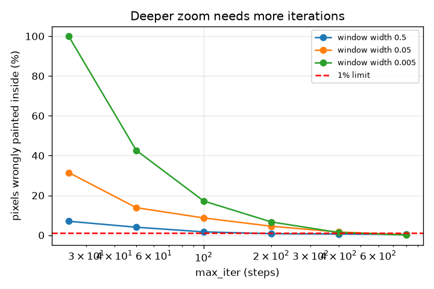
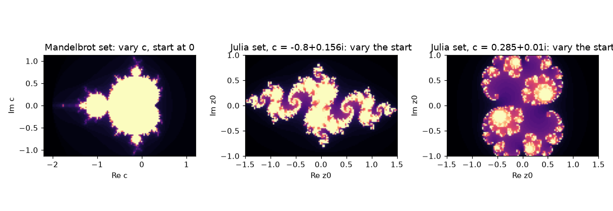

# Session 2: Modulus, argument and the escape-time algorithm

*Level 2 (mathematical engineering model) · about 75 minutes · openfractal*

> This is a simplified educational model. It is not a validated design tool and must not be used for real structures, electrical installations, vehicles, industrial processes or medical decisions.

**Prerequisites**

- Session 1: complex numbers and the orbit of z -> z^2 + c.
- Sine, cosine and the angle of a point (atan2).

**Learning objectives.** After this session you can:

- Compute the modulus and argument of a complex number and use them to multiply.
- Explain why an orbit beyond distance 2 can never return.
- Write the escape-time algorithm and use it to draw the Mandelbrot set and a Julia set.
- Choose the iteration limit for a given zoom with a measured error.

## A. Real-world problem
To draw the picture we must decide, for tens of thousands of pixels, whether an orbit escapes, and a computer cannot iterate for ever. How far must it go? Why is 2 the point of no return? And what is the difference between the Mandelbrot picture and a Julia picture, when both come from the same rule z -> z^2 + c? Finally, the practical question: when we zoom in, how many iterations do we need so that the boundary of the set is not smeared?

## B. Concept and theory
A complex number has a modulus |z| (distance from 0) and an argument arg z (angle from the real axis). Multiplying two numbers multiplies the moduli and adds the arguments; so squaring squares the modulus and doubles the angle, and the rule z -> z^2 + c is 'square and double, then slide by c'. The escape-time algorithm iterates the rule until |z| > 2 or a limit max_iter is reached and returns the number of steps used. Why 2: if |c| <= 2 and |z| > 2 then |z^2 + c| >= |z|^2 - 2 = |z| + (|z| - 2)(|z| + 1) > |z| + 3(|z| - 2), so the distance grows at least by a fixed positive amount every step and the orbit leaves for ever; if |c| > 2 then z1 = c is already beyond 2. The Mandelbrot set M is the set of c for which the orbit of z0 = 0 stays bounded; it lies inside the disc |c| <= 2. The (filled) Julia set of a fixed c is the set of starting values z0 whose orbit stays bounded; it is in one connected piece exactly when c is in M (a known fact we state without proof). Near the boundary orbits take long to escape, so with a finite max_iter some escaping pixels are wrongly painted inside.

| Symbol | Meaning | Unit |
|---|---|---|
| \|z\| | modulus: distance of z from 0 | no unit |
| arg z | argument: angle of z from the positive real axis | degrees |
| c | the constant of the rule (the pixel in a Mandelbrot picture) | no unit |
| z0 | starting value (the pixel in a Julia picture) | no unit |
| max_iter | iteration limit of the algorithm | steps |
| w | window width in the picture | same unit as c |
| error | share of pixels painted inside that escape later | fraction |

**Assumptions**

- Escape radius 2 and start z0 = 0 for the Mandelbrot set.
- The 'reference' escape times use 1500 steps, which is itself an approximation (a few pixels are still undecided).
- Windows are 40 by 30 pixels so that plain Python loops run quickly.

$$ |zw|=|z|\,|w|,\qquad \arg(zw)=\arg z+\arg w $$

$$ |z^2+c|\ \ge\ |z|^2-|c|\ \ge\ |z|+(|z|-2)(|z|+1)\quad(|z|>2,\ |c|\le 2) $$

$$ M=\{c:\ z_0=0,\ z_{k+1}=z_k^2+c\ \text{stays bounded}\} $$

$$ J_c=\{z_0:\ z_{k+1}=z_k^2+c\ \text{stays bounded}\} $$

## C. Visual explanation
The first figure shows three pictures from the same rule: the Mandelbrot set (vary c, start at 0) and two filled Julia sets (vary the start, c fixed at -0.8 + 0.156i and 0.285 + 0.01i), coloured by the escape time. The second figure plots the error (share of pixels wrongly painted inside) against max_iter for three window widths at the seahorse valley, c = -0.7436 + 0.1318i. The curves fall as max_iter grows, and the narrower the window the higher the curve: at width 0.5 the 1 percent limit needs 200 iterations, at 0.05 it needs 800.

*Share of wrongly-inside pixels against max_iter for three window widths at the seahorse valley.*

*One rule, three pictures: the Mandelbrot set and two Julia sets, coloured by escape time.*

## D. Interactive simulation
Run the lesson (`python start.py 2`), then open the live app: [Session 2: Julia set and the Mandelbrot test](https://krunalpanchal1995.github.io/openfractal/session-02/) (or `app.html` in this folder). Move c and watch two things: the filled Julia set on the left view and the orbit of 0 on the second view; the Julia set is one piece exactly when the orbit stays. Raise the iteration limit and see the edges sharpen.

**Challenge.** Pick a c with imaginary part at least 0.3 in size whose orbit of 0 still stays (so c is inside the Mandelbrot set).

## E. Worked example and experiment
**Problem.** For z = 3 + 4i and w = 1 + i, find the modulus and argument of z, w and z*w, and check the multiplication rule.

1. |z| = sqrt(3^2 + 4^2) = 5 and arg z = atan2(4, 3) = 53.13 degrees.
2. |w| = sqrt(2) = 1.414 and arg w = 45 degrees.
3. z * w = (3 + 4i)(1 + i) = 3 + 3i + 4i + 4 i^2 = -1 + 7i.
4. |z w| = sqrt(1 + 49) = sqrt(50) = 7.071, and |z| |w| = 5 * 1.414 = 7.071. They agree.
5. arg(z w) = atan2(7, -1) = 98.13 degrees, and arg z + arg w = 53.13 + 45 = 98.13 degrees. They agree.

**Answer.** |z| = 5, arg z = 53.13 degrees; |w| = 1.414, arg w = 45 degrees; z*w = -1 + 7i with modulus 7.071 and argument 98.13 degrees.

**Experiment.** Pick any window of a free Mandelbrot viewer, change its iteration limit from 50 to 500 and watch the boundary: thin filaments appear that were painted solid before. Compare with wrongly_inside from lesson.py. The model says the error falls with max_iter; a real viewer also changes colour mapping and anti-aliasing, and its own maximum is a fixed budget, so what you see is a mixture of the effects.

## F. Assessment and design challenge
**Question type A: Conceptual.** Why is it safe to stop iterating as soon as |z| > 2, but not safe to conclude 'stays' after any finite number of steps?

Hint

Think about which direction of the claim has a proof and which does not.

Step-by-step solution

Beyond 2 the distance grows by at least 3(|z| - 2) at every step, so the orbit can never come back: 'escapes' is a proof. 'Stays' after max_iter steps only means 'has not escaped yet': orbits near the boundary can take very long, as c = 0.3 needs 12 steps and points near the boundary need hundreds. So the picture's inside is an upper bound on the real set that gets better with max_iter.

**Question type B: Numerical.** Compute |z^2| and arg(z^2) for z = 3 + 4i, from the modulus and argument. Check by multiplying out.

Hint

Squaring squares the modulus and doubles the argument.

Step-by-step solution

|z^2| = 25 and arg(z^2) = 2 * 53.13 = 106.26 degrees. Check: (3 + 4i)^2 = 9 + 24i + 16 i^2 = -7 + 24i; modulus sqrt(49 + 576) = 25; angle atan2(24, -7) = 106.26 degrees. Units: none (the arguments are in degrees).

**Question type C: Graph and simulation interpretation.** In the iteration-error graph, why does each curve fall, and why is the curve for width 0.005 above the curve for width 0.5 at max_iter = 100?

Hint

Which pixels are wrongly inside, and where are they relative to the boundary?

Step-by-step solution

A pixel is wrongly inside if it escapes after max_iter steps. Raising max_iter lets more of them show their escape, so the error falls. A narrow window sits closer to the boundary where nearly every pixel is a slow escaper, so more of its pixels need long orbits: at max_iter = 100 about 17 percent of the width-0.005 window is wrong, against 1.7 percent for width 0.5. The values are measured, not derived, and the reference at 1500 steps is itself approximate.

**Question type D: Design and optimisation challenge.** Design: a zoom video moves from width 0.5 to width 0.005 at the seahorse valley. Choose max_iter for the first and last frame from the ladder 25, 50, 100, 200, 400, 800 with at most 1 percent wrong pixels, and say what you would do in between.

Hint

Run smallest_enough(SEAHORSE, width) for the two widths; try the same in-between.

Step-by-step solution

smallest_enough gives 200 for width 0.5 (errors 0.7 percent at 200, 1.7 percent at 100) and 800 for width 0.005 (1.3 percent at 400 is too much, 0.1 percent at 800). For the video interpolate max_iter on a log scale between 200 and 800 as the width shrinks, rounding up to the ladder. Trade-off: cost is roughly proportional to max_iter wherever many pixels are inside, so 800 costs four times as much as 200 per frame; a cheaper choice accepts a few percent of smeared pixels. Assumption: the reference with 1500 steps is accurate enough.

Score yourself with [RUBRIC.md](../../RUBRIC.md). Print the [activity sheet](activity_sheet.md) to work on paper.

## Common misconceptions
| Common misconception | What is actually true |
|---|---|
| The Julia set and the Mandelbrot set are two different rules. | Same rule z -> z^2 + c. For the Mandelbrot set c varies and the start is fixed at 0; for a Julia set c is fixed and the start varies. |
| Radius 2 is arbitrary; a smaller radius would do. | Radius 2 is the smallest round number for which we can prove the orbit never returns for every \|c\| <= 2. Points of M reach distance 2 (c = -2 gives the orbit 0, -2, 2, 2, ...), so a smaller radius would wrongly reject points of the set. |
| More iterations always fixes the picture. | More iterations sharpen the boundary but cost more, and at very deep zoom the limit becomes the precision of the numbers (Session 3). |
| Multiplying complex numbers multiplies the angles. | The moduli multiply and the angles add. |

## Glossary
- **modulus**: distance |z| of a complex number from 0
- **argument**: angle of a complex number from the positive real axis
- **escape-time algorithm**: iterate the rule until the distance exceeds 2 or a limit is reached; the step count is the escape time
- **Mandelbrot set**: all c whose orbit of 0 under z -> z^2 + c stays bounded
- **Julia set**: for a fixed c, all start values whose orbit stays bounded
- **max_iter**: the iteration limit: our patience

## Finish
1. Do the three coding tasks in [exercises.md](exercises.md).
2. Run `python start.py 2` again after your changes. It ends with the checkpoint; when it prints `PASS`, you are done. (Checkpoint only: `python start.py check 2`.)

Next: [Session 3](../session-03/README.md)
