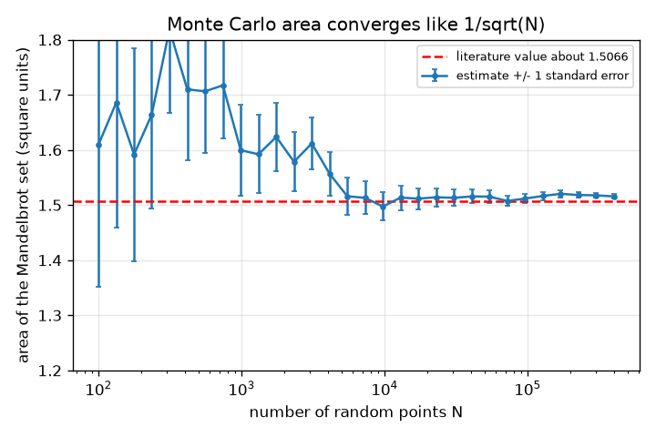
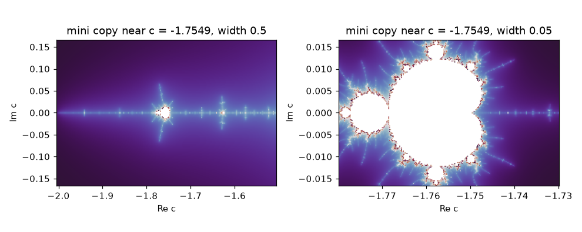
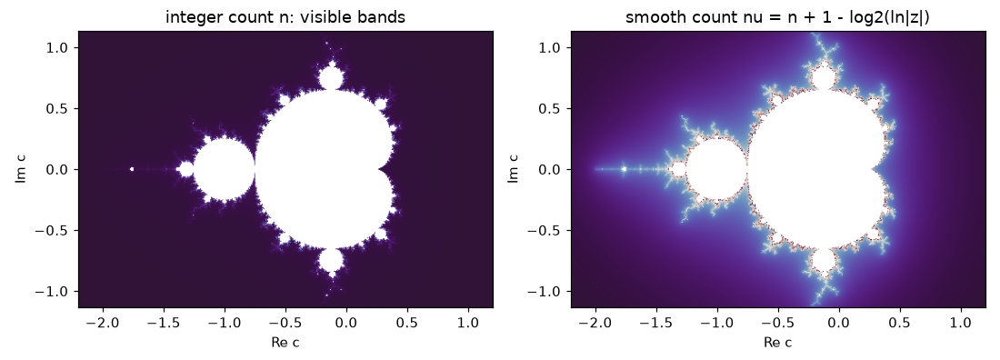

# Session 3: A fast renderer: smooth colour, area and the limits of floating point

*Level 3 (simulation and validation) · about 90 minutes · openfractal*

> This is a simplified educational model. It is not a validated design tool and must not be used for real structures, electrical installations, vehicles, industrial processes or medical decisions.

**Prerequisites**

- Session 2: escape time, Mandelbrot and Julia sets.
- Numpy arrays (explained as they appear).

**Learning objectives.** After this session you can:

- Write a vectorised numpy renderer that iterates all pixels at once and counts its own cost.
- Colour pixels smoothly with the continuous escape count nu = n + 1 - log2(ln|z|).
- Validate the renderer against known points and against an area estimated by Monte Carlo sampling, with an error bar.
- Find where double-precision numbers stop being enough for a deep zoom.

## A. Real-world problem
A zoom video needs hundreds of frames, so a Python loop over pixels is hopeless; and a picture coloured by integer counts shows ugly bands. How do we make the renderer fast and smooth? And how do we know a renderer is right, when the true picture is infinitely complicated? Finally, every zoom video has a limit: somewhere around a magnification of 10^13 the picture turns into blocks. Where exactly, and why?

## B. Concept and theory
The vectorised renderer keeps every pixel's z in one array and does z = z*z + c for all unfinished pixels at once, removing a pixel from the list when |z| exceeds a large bailout radius (256). The work is counted as the total number of z-updates. The integer escape count n gives colour bands; the continuous count nu = n + 1 - log2(ln|z_n|) interpolates between them, because near the escape |z| roughly squares each step, so ln|z| doubles and log2 of it measures the fraction of a step; nu hardly changes with the bailout radius. To check the renderer we use known points (c = 0 inside, c = 1 outside, c = -1 periodic, c = -2 on the boundary and still inside, c = -2.0001 outside) and the area of M: for N random points in the upper half-box [-2, 0.5] x [0, 1.15] with a fraction p inside, area = 2 * 2.875 * p, with statistical error 2 * 2.875 * sqrt(p (1 - p) / N), which falls like 1/sqrt(N); a finite max_iter makes the estimate slightly too large. The literature value of the area is about 1.5066. Finally, a float64 number carries about 16 significant digits, so near x = -0.74 neighbouring floats are about 1.1e-16 apart; when the pixel spacing w/nx approaches that, neighbouring pixels get the same coordinate.

| Symbol | Meaning | Unit |
|---|---|---|
| n | first step with \|z\| above the bailout (integer escape count) | steps |
| nu | continuous (smooth) escape count | steps |
| work | total number of z-updates performed | updates |
| N | number of random sample points | count |
| p | fraction of sample points that look inside | fraction |
| A | area of the Mandelbrot set | square units of the c plane |
| w | window width | same unit as c |
| nx | image width in pixels | pixels |

**Assumptions**

- Bailout radius 256 (the smooth colour needs |z| well beyond 2).
- The set is symmetric about the real axis, so only the upper half is sampled.
- Sample points are independent and uniform; the random generator is seeded so the result is reproducible.
- Plain float64 arithmetic (no extra precision).

$$ \nu=n+1-\log_2\!\big(\ln |z_n|\big) $$

$$ A\approx 2\,A_{\mathrm{box}}\,p,\qquad A_{\mathrm{box}}=2.5\times1.15=2.875 $$

$$ \sigma_A=2\,A_{\mathrm{box}}\sqrt{\frac{p(1-p)}{N}} $$

$$ \text{pixels collapse when }\ \frac{w}{n_x}\ \lesssim\ \varepsilon_{\mathrm{mach}}\,|x|\approx 1.1\times10^{-16}\times 0.74 $$

## C. Visual explanation
The first figure shows the whole set twice: coloured by the integer count n (visible bands) and by the smooth count nu (continuous colour). The second plots the Monte Carlo area estimate with one-standard-error bars against the number of random points on a log axis, with the literature value as a dashed line: the bars shrink like 1/sqrt(N) and the estimate settles near 1.516 (finite max_iter) rather than exactly at 1.5066. The third figure shows the period-3 mini copy of the whole set at two zoom levels, the second at width 0.05.

*Monte Carlo area estimate with error bars against the number of random points.*

*The period-3 mini copy of the Mandelbrot set near c = -1.7549 at two zoom levels.*

*Integer escape count (bands) against the smooth continuous count.*

## D. Interactive simulation
Run the lesson (`python start.py 3`), then open the live app: [Session 3: zoom, iterations and cost](https://krunalpanchal1995.github.io/openfractal/session-03/) (or `app.html` in this folder). Zoom into the seahorse valley with the zoom slider and watch the pixel picture. In the cost view see how the work grows with the iteration limit, and in the readout watch the share of pixels painted inside that would really escape.

**Challenge.** At zoom 3 (window width 0.003) choose an iteration limit between 240 and 260: fewer than 4.5 percent of the pixels painted inside and the work below 600 thousand updates.

## E. Worked example and experiment
**Problem.** For c = 1, find the integer count n with bailout 256, the escape value z_n, and the smooth count nu by hand.

1. The orbit of c = 1 is 0, 1, 2, 5, 26, 677, so the first value above 256 is z5 = 677 and n = 5.
2. ln 677 = 6.518.
3. log2(6.518) = ln 6.518 / ln 2 = 1.8745 / 0.6931 = 2.7044.
4. nu = n + 1 - log2(ln|z|) = 5 + 1 - 2.7044 = 3.296.

**Answer.** n = 5, z5 = 677, nu = 3.296. (With the bailout 2 the integer count would be 3; the smooth count is built to agree between bailouts, up to a constant that we ignore in colouring.)

**Experiment.** Run the Monte Carlo estimate with a different seed and with N = 10,000, 100,000 and 400,000 and compare each estimate and its error bar with 1.5066 (checkpoint.py does the middle one). Then open any free Mandelbrot viewer at width 1e-14 and compare with `distinct_columns`. In both cases the model (independent random points, exact arithmetic on 16 digits) explains the trend but not the details: real random numbers are pseudo-random and real viewers use smarter arithmetic, so their limit is deeper than ours.

## Real-world application and mini-project: Find and render a mini-Mandelbrot
Deep inside the picture, along the negative real axis, sits a small copy of the whole Mandelbrot set. Its centre is the real number c3 for which the orbit of 0 returns to 0 after exactly 3 steps. Use `period3_centre` and `mislabelled` from Session 3 to locate it, render it, and find how many iterations a window of width 0.05 around it needs.

**Deliverable:** A script that prints c3 and the value of |z3| for it, prints the share of mislabelled pixels for max_iter = 50, 100, 200, 400 and 800 in a window of width 0.05, names the smallest value that keeps the share below 1 percent, and saves a picture of the mini copy.

**Success looks like:** c3 = -1.7548776662 with |z3| below 1e-9, the smallest sufficient max_iter on that list is 400 (it mislabels 0.4 percent; 200 mislabels 1.3 percent), and the saved picture shows a small copy of the whole set.

## F. Assessment and design challenge
**Question type A: Conceptual.** Why does the continuous count nu remove the colour bands, and why does it hardly depend on the bailout radius?

Hint

Think about how |z| changes in the last step before and after crossing the bailout.

Step-by-step solution

Near escape the update z -> z^2 + c is dominated by z^2, so |z| roughly squares each step and ln|z| doubles; hence log2(ln|z|) increases by about 1 per step. The integer count n only changes in whole steps, but nu = n + 1 - log2(ln|z_n|) subtracts the fraction of the last step by which |z_n| overshot the bailout, so pixels that escape 'a little later' get a slightly larger nu. Changing the bailout from 256 to 10,000 changes n by about 1 and log2(ln|z|) by about 1 as well, so nu is nearly unchanged (differences below 1e-4 in the checkpoint).

**Question type B: Numerical.** A Monte Carlo run with N = 400,000 points gives a fraction p = 0.2631 inside the half-box. Give the area and the error bar. How many points would give an error bar half as large?

Hint

Use A = 2 * 2.875 * p and sigma = 2 * 2.875 * sqrt(p (1 - p) / N).

Step-by-step solution

A = 5.75 * 0.2631 = 1.513 (square units). sigma = 5.75 * sqrt(0.2631 * 0.7369 / 400000) = 5.75 * 0.000696 = 0.0040. The error scales like 1/sqrt(N), so halving it needs four times as many points, N = 1.6 million. Sanity check: the result agrees with 1.5066 within about 1.6 standard errors. (The run in lesson.py with max_iter 2000 gives 1.5157 +/- 0.0040.)

**Question type C: Graph and simulation interpretation.** In the cost graph, why is the curve almost a straight line at a shallow zoom and bends over at a deep zoom?

Hint

Which pixels use all max_iter steps, and which stop early?

Step-by-step solution

A pixel that stays inside uses all max_iter steps, an escaping pixel uses only its escape count. If many pixels are inside, cost grows about proportionally to max_iter (a straight line with slope = the number of inside pixels). When most pixels are outside and escape within a few hundred steps, raising max_iter beyond their escape times adds no work, so the curve flattens (compare the full-set cost 2.8 million at 800 against 0.79 million at 200, with the seahorse window at width 0.01: 2.2 million against 1.5 million).

**Question type D: Design and optimisation challenge.** Design: you want a zoom video that stops at width 1e-13 and uses 200 pixel columns. Show that float64 is enough for the last frame and not for width 1e-15. Then propose what to do for the video to go to 1e-30.

Hint

Use distinct_columns(SEAHORSE, width, 200) for several widths.

Step-by-step solution

At width 1e-13 all 200 columns have different coordinates, at 1e-14 only 91 do, at 1e-15 only 9 and at 1e-16 just 1, so float64 works down to about 1e-13 for 200 columns and then the picture turns into blocks. To go to 1e-30 you need more precision than 16 digits: arbitrary-precision numbers for one reference orbit and ordinary floats for the small differences from it (perturbation theory), which is the road to the Target. Trade-off: more digits cost more time per frame.

Score yourself with [RUBRIC.md](../../RUBRIC.md). Print the [activity sheet](activity_sheet.md) to work on paper.

## Common misconceptions
| Common misconception | What is actually true |
|---|---|
| The Monte Carlo area should equal 1.5066 exactly if the code is right. | It has a statistical error bar of 0.004 at N = 400,000 and a small upward bias from the finite max_iter (0.05 at 100 iterations, 0.015 at 500, 0.009 at 2000 for this seed). The check is agreement within the error, not equality. |
| Smooth colouring changes which pixels are inside. | It only recolours pixels that have escaped; the classification inside or outside is the same. |
| Vectorising makes the arithmetic itself cheaper. | It removes Python's per-pixel overhead; the number of z-updates is the same. That is why we count work separately from time. |
| Zooming deeper is only a matter of more iterations. | At a width near 1e-13 for ordinary floats the pixels run out of distinct coordinates, whatever the iteration limit. |

## Glossary
- **vectorised**: done for a whole array at once instead of one value at a time in a Python loop
- **bailout radius**: the distance at which we stop iterating a pixel (256 here)
- **smooth colouring**: colouring by the continuous escape count nu instead of the integer n
- **Monte Carlo**: estimating a quantity from random samples; the error falls like 1/sqrt(N)
- **machine epsilon**: the relative spacing of floating-point numbers, about 1.1e-16 for float64
- **perturbation theory**: computing one very precise reference orbit and the small differences of nearby orbits from it

## Finish
1. Do the three coding tasks in [exercises.md](exercises.md).
2. Run `python start.py 3` again after your changes. It ends with the checkpoint; when it prints `PASS`, you are done. (Checkpoint only: `python start.py check 3`.)

Next: the [roadmap](../../promo/roadmap.md). Session 4 is yours to build.
